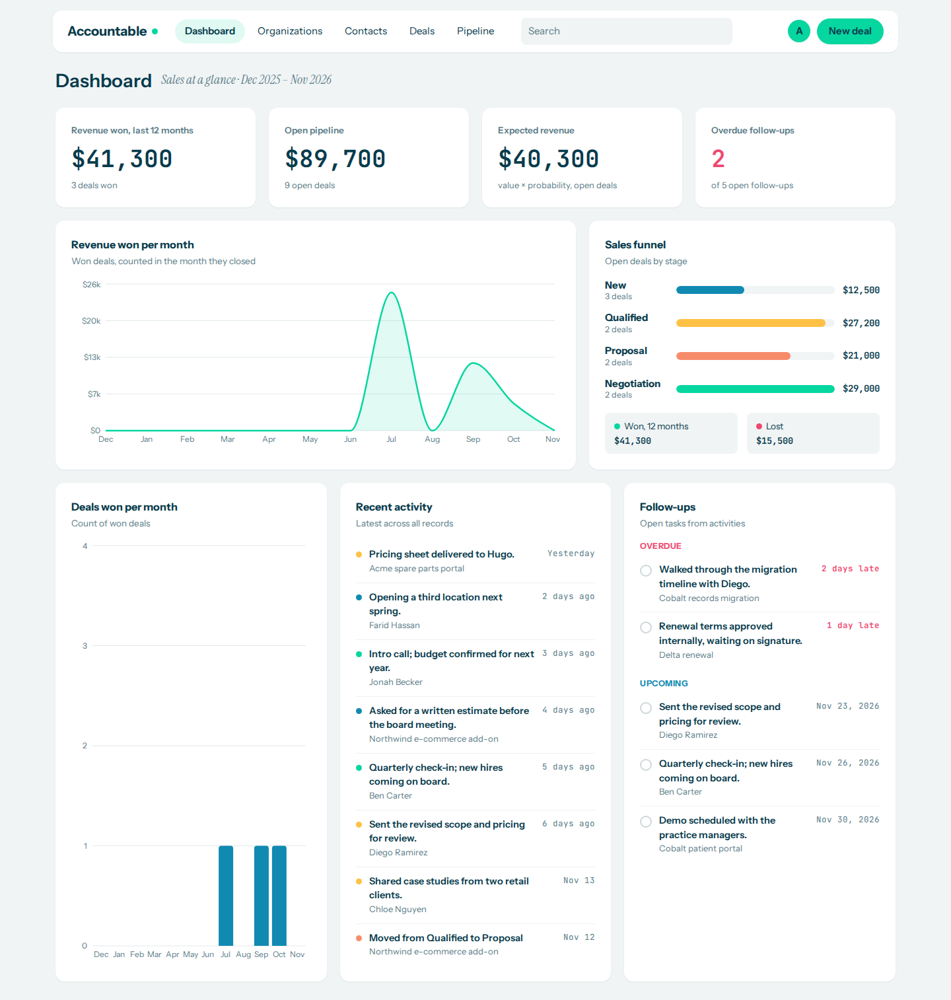
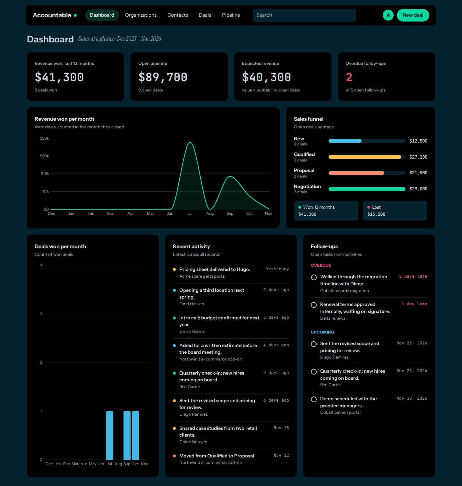
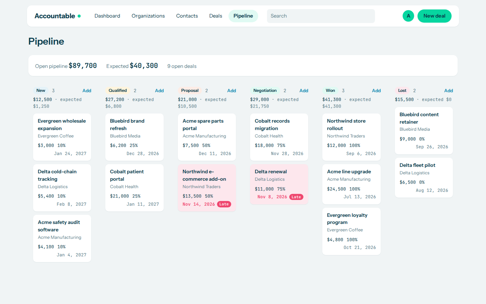

# Accountable

A sales CRM for a small team, on the web — the everyday CRM essentials done well, built to grow into a full Business OS. A private Salesforce for one team: organizations, contacts, deals, a pipeline board, activities and follow-ups, with a dashboard that shows how sales are going at a glance.

**Live: [accountable-qie9.onrender.com](https://accountable-qie9.onrender.com/)** — sign in with your email and password (people are added in Supabase's dashboard; there is no sign-up page).



## Features

- **Dashboard** — revenue won in the last 12 months, open pipeline, expected revenue, overdue follow-ups, the sales funnel, recent activity and the follow-up list, all computed server-side from one endpoint.
- **Organizations, contacts, deals** — full list pages with search, sorting and filters, detail pages with a newest-first timeline, and add/edit dialogs.
- **Pipeline** — the open deals as cards on a board, one column per stage, drag between or within columns, with column totals and late deals called out.
- **Activities and follow-ups** — log calls, emails and tasks on a record, with overdue and upcoming follow-ups on the dashboard and a mark-done checkbox.
- **Team sign-in** — Supabase Auth with email and password; every record shows who added it and who last changed it.
- **Search** — one search box in the top bar across organizations, contacts and deals, plus the search box on each table.
- **Light, dark and system** — the theme follows the device or your choice, remembered across visits, WCAG AA contrast in both modes.
- **Safe deletes** — a confirmation lists exactly what a delete will cascade to, with counts and names, before anything is removed.

## Screenshots

| Light mode                                                                                               | Dark mode                                                                                                |
| -------------------------------------------------------------------------------------------------------- | -------------------------------------------------------------------------------------------------------- |
|                                                     |                                                       |



## Tech stack

| Layer       |                                                                                                   |
| ----------- | --------------------------------------------------------------------------------------------------- |
| Backend     | FastAPI, SQLAlchemy Core, SQLite locally / Postgres on Supabase, Alembic migrations, Pydantic settings |
| Frontend    | React 19, TypeScript, Vite, TanStack Table, Recharts, dnd-kit                                        |
| Sign-in     | Supabase Auth (RS256 JWT verified on every request) and a local sign-in for the sample data           |
| Tests       | pytest (backend), Vitest (frontend), Playwright (end-to-end on Chrome), node:test (scripts)           |
| Quality     | Prettier, ESLint, ruff, ty, complexity ≤ 15, gitleaks, unit coverage ≥ 80% — all in `npm run check`    |
| Deployment  | Render (`render.yaml`) in front of Supabase, one free web service                                     |

Details: [docs/TECH_STACK.md](docs/TECH_STACK.md).

## Quick start

Requires Node 24 or later, Python 3.12 with [uv](https://docs.astral.sh/uv/), and Chrome for the end-to-end tests.

```bash
npm install
npm run dev
```

That starts the backend (http://127.0.0.1:8000) and the frontend (http://localhost:5173) together against a local SQLite database filled with sample data. Pick a made-up teammate on the sign-in screen and use it — no Supabase project and no `.env` needed.

| Command            | What it does                                                                                  |
| ------------------ | ----------------------------------------------------------------------------------------------- |
| `npm run dev`      | The local copy: backend + frontend, sample data, made-up teammates                                |
| `npm test`         | Everything: backend, frontend, scripts and end-to-end tests                                      |
| `npm run seed`     | Rebuild the sample data, naming the database it will wipe before asking                          |
| `npm run check`    | Every gate: formatting, lint, type checks, secrets and tests with coverage                        |
| `npm run check:quick` | The same without the end-to-end tests                                                        |
| `npm start`        | The shared copy, the way Render runs it: needs `DATABASE_URL`, `SUPABASE_URL`, `SUPABASE_PUBLISHABLE_KEY` in `.env` |

Stop a running `npm run dev` before `npm test` — the end-to-end run starts the app itself on fixed ports.

## Deploying

The app is set up for Render's free plan as one web service (`render.yaml`): the build compiles the frontend, the backend serves it and runs the migrations on start, and the API answers 401 until you sign in.

1. Create a Supabase project and add your team's users under Authentication → Users, then turn sign-ups off — there is no sign-up page.
2. Put `DATABASE_URL`, `SUPABASE_URL` and `SUPABASE_PUBLISHABLE_KEY` in Render's environment for the service (they are named `sync: false` in `render.yaml`, so their values never live in the file).
3. Deploy; `npm run seed` against the same settings fills an empty Supabase database with sample data.

See [docs/specs/running.md](docs/specs/running.md) for both ways to run it.

## Project layout

- `backend/` — the FastAPI app, migrations and pytest suite.
- `frontend/` — the React app, its styles and the Vitest suite.
- `e2e/` — the Playwright suite; `playwright.config.ts` starts the app itself.
- `scripts/` — `seed`, `start` and the `.env` splitting they share.
- `docs/` — the spec and its area files, standards, status, and one folder per change.
- `plugins/hooks/` — the OpenCode hooks: the turn-end check and `.env` protection.
- `course/` — material from the course this repo started from; see the credit below.

## Documentation

- [docs/spec.md](docs/spec.md) — what the product is, problem statement and the index of area specs (start here).
- [docs/STATUS.md](docs/STATUS.md) — what is built, reviewed and left to do.
- [docs/STANDARDS.md](docs/STANDARDS.md) — how the code is written here.
- [docs/TECH_STACK.md](docs/TECH_STACK.md) — the stack in more detail.

## Where it stands

Done and reviewed: the CRM MVP (accepted), multi-user sign-in on Supabase with attribution and search, light/dark/system themes, the quality harness (pre-commit hooks, turn-end checks, CI on every push) and the app deployed to Render.

Next: the pieces deliberately left out for now — roles and permissions, mobile layout, AI features, integrations, currencies other than USD, tags, custom fields, import/export. The full list is in [docs/spec.md](docs/spec.md); the running log is [docs/STATUS.md](docs/STATUS.md).

## Acknowledgements

Forked from [ed-donner/accountable](https://github.com/ed-donner/accountable), the project for Ed Donner's course *The AI-Native Software Engineer in the Agentic Era*. This repository is my own build of Accountable; the course material still lives here under `course/`, and the full course guide is at the upstream repo.
